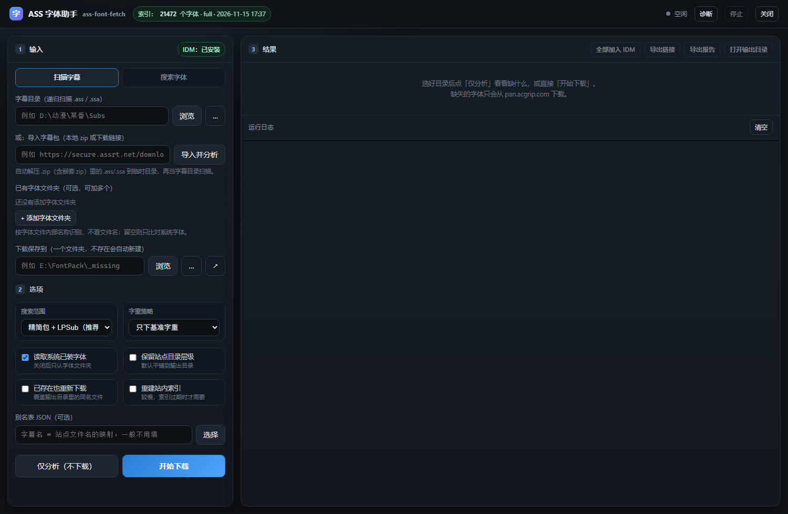
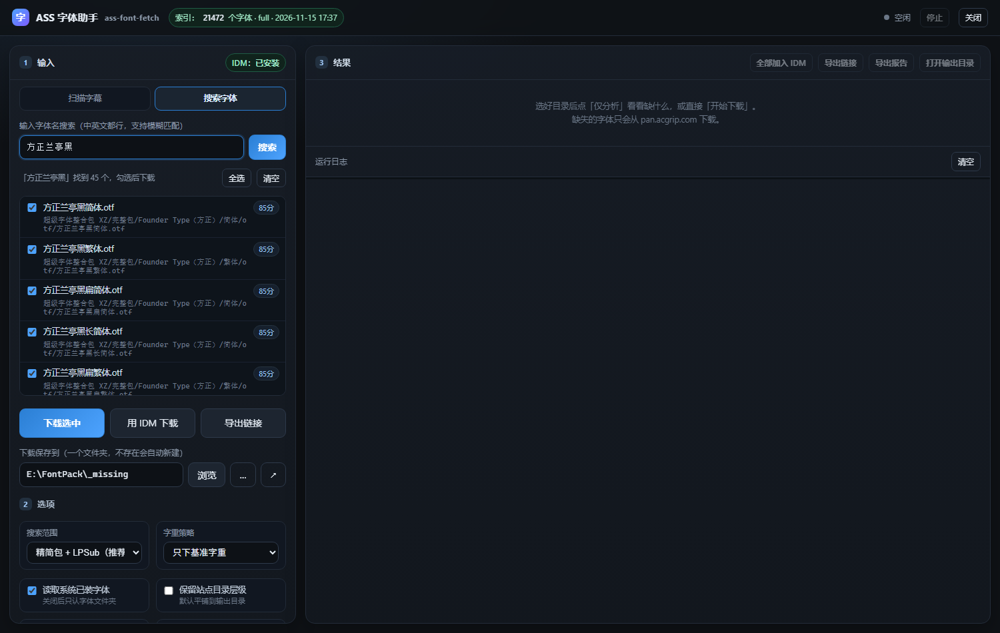
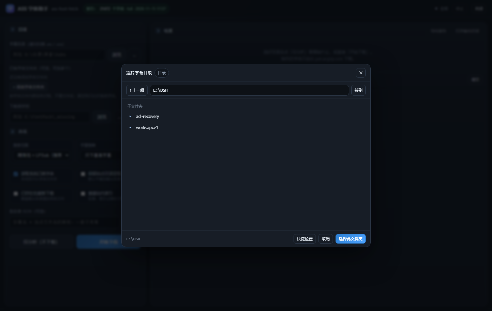
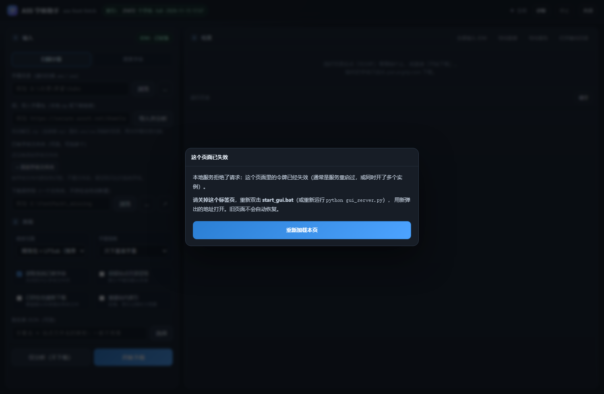

# ass-font-fetch

点击启动.bat运行

扫描 ASS/SSA 字幕用到的字体 → 对比**系统已安装字体**与**指定字体文件夹** → 找出缺失的 → 从
[pan.acgrip.com](https://pan.acgrip.com/)（Anime 字幕论坛字体下载站）自动下载到指定目录。

纯 Python 标准库实现，**不需要 pip 安装任何依赖**，Python 3.9+ 即可。

## 可视化页面（推荐）

双击 **`start_gui.bat`**，或者在命令行里：

```bash
python gui_server.py            # 自动打开浏览器；加 --no-browser 不自动开
python gui_server.py --port 9000
```

启动后会自动打开 `http://127.0.0.1:8771/?t=<一次性 token>`（只监听本机，token 每次启动随机，
同机器上别的程序没法直接调你的接口）。

页面能做的事：

- **两个标签页**：「扫描字幕」（默认）和「搜索字体」；
- **搜索字体**：直接输入字体名（中英文、模糊匹配都行），列出站内匹配到的文件 + 匹配分，
  勾选后「下载选中」；也可以「用 IDM 下载」或「导出链接」；
- 三个目录都支持「浏览」：内置目录树（驱动器 / 上级 / 快捷位置 / 手动输路径），
  也可以点旁边的「…」调起 Windows 原生选择框；
- **「下载保存到」填的是一个文件夹**（不是文件）：下载的 `.ttf/.otf/.ttc` 都放这里，
  不存在会自动新建，建议单独建一个空文件夹，别选 `C:\Windows\Fonts` 这类系统目录；
  没选它时点开始会直接弹出选择框，选完路径同时记进浏览器；
- 字体文件夹可以加多个，随时移除；
- 选范围（精简包+LPSub / 整站）、字重策略、是否读系统字体、是否保留目录层级、是否强制重下、是否重建索引；
- **下载进度**：顶部是总进度「已完成 2 / 5 个字体」+ 总字节，下面每个文件一行——各自一条进度条、
  百分比、已下/总大小、实时速度；完成的变绿、失败的变红；
- **IDM 支持**：右上角会显示 IDM 是否安装；装了就点「用 IDM 下载」，脚本会把
  下载链接按 `/d URL /p 目录 /f 文件名` 交给 IDMan.exe，进度在 IDM 里看；
  没装也能「导出链接」，得到 `font_links.txt`，IDM 里「任务 → 从文本文件导入」即可；
- **扫描也会用找字网**：acgrip 匹配不到时自动去「找字网」再搜一次（结果里标「（找字网）」），
  两个源分开匹配、互不覆盖；不需要可在选项里关掉；
- **找字网多文件**：找字网一个字体常带多个文件（不同字重、不同来源）。默认只下**一个**
  （名字最像正规字体名、且跳过 Bold/Italic 的那个）；「用 IDM 下载」「导出链接」也默认只发这一个，
  不会把整页文件都塞进队列。想看/想下其它文件，点「文件…」在弹窗里勾选；
- **搜索页的「待找字体」**：扫描完会把没匹配到的字体列在「搜索字体」页顶部，可勾选/全选后
  「批量搜索」，结果按字体分组显示；
- **导入字幕包**：直接把 `.zip` 字幕包（或下载链接）填进去，自动解出 `.ass/.ssa` 再分析字体——
  像 `https://secure.assrt.net/download/182242/….zip` 这种字幕包就属于这一类；
- 「仅分析」出清单，「开始下载」直接下；运行中可「停止」；
- 右边实时日志（分阶段高亮）+ 结果区（缺失数 / 已下载 / 未找到 / 失败，逐条列出站点路径与本地文件）；
- 一键「打开输出目录」「导出报告」（JSON）。






## 搜不到 / 下不动 / IDM 显示未安装？

先点右上角 **诊断**：里面直接给出服务版本、PID、索引文件位置与字体数量、IDM 检测到的路径、
进程里有没有任务在跑。几个高频原因：

1. **开了多个服务实例**（以前常见）：浏览器页面来自实例 A，任务跑在实例 B，于是「搜索没结果、
   下载没进度、IDM 显示未安装」。现在服务端是单实例 + 独占端口：
   第二次启动会直接打印「已经有一个实例在运行」并给出可用的地址，不会再抢端口；
   想强制重启用 `python gui_server.py --force`。
2. **页面放太久没关**（服务重启过 / 令牌变了）：页面会弹「这个页面已失效」，按提示关掉重开即可
   （页面加载时会跟 `/api/ping` 对版本，接口返回 403 也会立刻提示，不会再静默失败）。
3. **索引缺失或被删**：诊断里 `index.exists=false` 就重建一次（命令行 `--refresh-index`）。

## 打包 / 拷到另一台电脑

### 方式一：拷源码（目标机器要有 Python 3.9+）

把整个 `ass-font-fetch` 目录拷过去，双击 `start_gui.bat` 即可。目录自带索引
（`acgrip_index.json` 1.8 MB），不需要联网重建。

### 方式二：用打包好的 exe（目标机器不需要 Python）

`发布包/ass-font-fetch-portable.zip`（约 12 MB）解压到**有写权限的目录**（别放
`C:\Program Files`），双击里面的 `启动.bat`（或直接 `ass-font-fetch.exe`）。

- 单文件 exe，内置 Python 3.12 + 页面 + 索引，双击即用；
- 第一次运行会在 exe 旁边生成 `acgrip_index.json`（站点索引）和 `.gui.lock`；
- 控制台窗口不能关，关掉就等于停止服务；
- 单文件 exe 启动时要把自己解包到临时目录（约 1–2 秒）。如果那台机器的
  `%TEMP%` 不让建目录、报 `Could not create temporary directory`，请用 `启动.bat`
  启动——它会把 `TEMP` 指到 exe 旁边的 `_tmp`。

### 自己重新打包

```bash
python -m pip install pyinstaller
python build_exe.py
# 产物：_dist/ass-font-fetch.exe
```

如果双击 exe 没反应，用包里的 **`诊断启动.bat`**：它会把窗口停住并写出 `启动日志.txt`，
把里面的内容发出来就能判断是代码问题还是被杀软/SmartScreen 拦了。

`build_exe.py` 会把 `gui.html`、`acgrip_index.json`、`sources.json` 一起塞进 exe；
打包版的 `--cli` 子命令可以当作命令行版用（`ass-font-fetch.exe --cli --search Roboto`）。

## 字体源

目前内置两个源：

| 源 | 类型 | 说明 |
|---|---|---|
| `acgrip` | 目录索引 | Anime 字幕论坛字体站，索引随包附带（2 万多个文件） |
| `zhaozi` | 在线搜索 | 找字网（font-c0.zhaozi.org），按名字实时搜索，详情页里直接给出下载直链；不需要索引 |

用法：

```bash
# 在找字网搜
python ass_font_fetch.py --source zhaozi --search 方正兰亭黑

# 直接下载找字网详情页里的字体（会自动挑一个正经文件名，跳过 Bold/Italic 变体）
python ass_font_fetch.py --download "https://font-09.zhaozi.org/0/9/098b….htm" --out E:\FontPack
```

GUI 里「搜索字体」页的字体源下拉框会多出「找字网（在线搜索）」。

想再加别的**目录型**镜像站，编辑 [`sources.json`](sources.json)：

```json
{
  "sources": [
    { "name": "acgrip", "label": "Anime字幕论坛字体站",
      "base": "https://pan.acgrip.com/", "index": "acgrip_index.json" },
    { "name": "mysite", "label": "我的镜像",
      "base": "https://fonts.example.com/", "index": "index_mysite.json" }
  ]
}
```

要求目标站是同一种目录列表形式（`https://站点/?dir=子目录`，文件是 `站点/路径/文件名`）。
加好后命令行用 `--source mysite --refresh-index` 抓一次索引；GUI 里源多于一个时会多出下拉框。

> **关于 https://secure.assrt.net/**：它是「伪射手」字幕站（40 多万条字幕的存档），**不是字体站**，
> 页面里下载的是 `.ass/.ssa` 字幕包，没有字体文件可抓；而且当前网络连不上它
> （DNS 解析到 75.127.89.2，但 TCP/TLS 超时）。所以没有把它接入成字体源。
> 它提供的「下载」链接是**字幕 zip 包**（例如你给的 `…/download/182242/….zip` 就是《千与千寻》的中日双语字幕包），
> 所以正确的接入方式是「**导入字幕包**」：把链接或 zip 路径填到页面「或：导入字幕包」里，
> 工具会解出字幕再分析它需要哪些字体——这比把它当字体源更实际。
> 注意：assrt 从这台机器目前连不上（`WinError 10054` / TCP 超时），需要能访问它的网络；
> 或者你先把 zip 下到本地，再把本地路径填进去。

## 快速开始

```bash
# 1) 先看看缺什么（只分析，不下载）
python ass_font_fetch.py --ass-dir "D:\动漫\某番\Subs" --font-dir "E:\FontPack" --out "E:\FontPack\_missing" --dry-run

# 2) 确认没问题后正式下载
python ass_font_fetch.py --ass-dir "D:\动漫\某番\Subs" --font-dir "E:\FontPack" --out "E:\FontPack\_missing"

# 3) 想连「完整包」范围一起搜（索引更大、更全）
python ass_font_fetch.py --ass-dir . --font-dir E:\FontPack --out E:\FontPack\_missing --scope full --refresh-index

# 4) 不扫字幕，直接在站内搜字体名
python ass_font_fetch.py --search 方正兰亭黑

# 5) 直接下载某个站内文件（加 --progress-json 会输出机器可读进度）
python ass_font_fetch.py --download "LPSub Fonts/2023-12-24/Roboto-Medium.ttf" --out E:\FontPack\_missing --progress-json
```

> **已附索引**：目录里带了 `acgrip_index.json`（2026-11-15 抓取，整站 21,472 个字体文件），
> 所以第一次运行就能直接匹配、秒出结果。`--refresh-index` 才会重新抓；站点本身很慢
> （实测每个目录页 1–7 秒，有时会卡住），重建整站索引大约 15–20 分钟，`lite` 范围约 2 分钟。
>
> 单个字体文件也要从那个站现下，中日文字体动辄 5–40 MB，**一个字体下几分钟是正常的**，
> 脚本给单个文件留了 600 秒超时并重试 2 次。

## 参数

| 参数 | 说明 |
| --- | --- |
| `--ass-dir DIR` | 字幕文件夹，递归扫描 `.ass` / `.ssa`（自动处理 UTF-8/UTF-16/GBK/BIG5/Shift-JIS 编码）。用 `--search`/`--download` 时可省略 |
| `--search NAME` | 只搜字体名（不扫字幕、不下载），列出站内候选与分数 |
| `--download PATH` | 直接下载站内某个文件，可重复；支持 `源名::路径` 前缀 |
| `--source NAME` | 字体源名称（见 `sources.json`），默认 `acgrip` |
| `--progress-json` | 输出 `@@PROGRESS` / `@@FILE` / `@@TOTAL` 机器可读进度行（GUI 用） |
| `--font-dir DIR` | 要比对的字体文件夹，可重复写多次；里面的字体按**内部 family 名**识别，不看文件名 |
| `--out DIR` | 下载保存目录，默认 `./fonts_downloaded` |
| `--index FILE` | 站内索引缓存，默认脚本旁的 `acgrip_index.json` |
| `--refresh-index` | 强制重建索引（站点更新后想要新字体时用） |
| `--scope {lite,full}` | 索引范围：`lite` = LPSub Fonts + 超级字体整合包 XZ/精简包（默认，覆盖大多数常见字幕）；`full` = 整站，含完整包 |
| `--max-age-days N` | 索引多少天内直接复用，默认 90 |
| `--jobs N` | 抓索引的并发数，默认 3 |
| `--aliases FILE` | 别名表 JSON，用于「字幕里的名字 ↔ 站点里的文件名」对不上时手工指定 |
| `--variants {base,all}` | 同族字体只下基准字重（默认）还是全部字重（`all` 会把 bold/medium 等一起拉下来） |
| `--dry-run` | 只分析、列清单，不下载 |
| `--yes` | 有多个候选时自动选最匹配的，不交互询问 |
| `--force` | 已存在也重新下载 |
| `--keep-tree` | 保留站点的目录层级（默认平铺到 `--out`） |
| `--no-system` | 不读取系统已安装字体 |
| `--report FILE` | 额外输出 JSON 报告（用到哪些字体、缺哪些、下到哪） |
| `--verbose` | 打印更多过程信息 |

退出码：`0` 全部搞定；`3` 有字体站内没找到或下载失败；`2` 参数/目录错误。

## 工作原理

1. **解析字幕**：读 `[V4+ Styles]` / `[V4 Styles]` 的 `Fontname` 列，同时扫字幕正文里的
   `{\fn字体名}` 覆盖标签（`\r` 重置样式按样式本身处理）。去掉 `@`（竖排前缀）。
2. **已装字体识别**：Windows 下读 `C:\Windows\Fonts`、`%LOCALAPPDATA%\Microsoft\Windows\Fonts`
   和注册表字体项；其它平台用 `fc-list` 兜底。每个字体文件都会解析 sfnt `name` 表，取出
   family / typographic family / full name / PostScript 名（含中日繁各语言名），所以
   「文件名是 `SourceHanSansCN-Bold.ttf`、显示名是 `思源黑体 CN`」这种情况也能认出来。
3. **比对**：字体名统一做全角转半角、小写、去空格/下划线/连字符/点后比较；再去掉末尾字重词
   （Bold/Medium/Light…）做「同族」比较；还会忽略结尾的编码后缀（`_GBK`/`-GB18030`/`_BIG5`）
   和地区后缀（CN/TC/SC/HK…，仅作低分兜底，避免把繁体当成简体）。这样
   `Source Han Sans` ↔ `SourceHanSansCN-Regular`、`方正兰亭黑` ↔ `方正兰亭黑_GB18030`
   都能配上。
4. **匹配分两轮**：先把所有缺失字体统一在 acgrip 里匹配；acgrip 都没找到的，再**统一**拿到
   「找字网」按名字搜一次（结果里标「（找字网）」）。两站的匹配逻辑互不干扰。
5. **下载**：acgrip 命中就下站内文件；找字网命中则默认只下详情页里的**第一个**文件
   （按文件名质量排序，优先正规名、跳过 Bold/Italic）。同一字体在找字网可能有好几个文件，
   页面上点「文件…」可以看到全部并手动勾选下载。下载后都会校验文件魔数，非字体内容丢弃。

索引的结构就是站点目录的 BFS 结果（`?dir=` 逐层抓取），存成
`{"version":1,"scope":"lite","files":["LPSub Fonts/.../xxx.ttf", ...]}`。

## 用 IDM 下载

三种方式，任选：

1. GUI「搜索字体」页 → 勾选 → **用 IDM 下载**（需要已装 IDM，页面右上角显示检测结果）；
   脚本对每个文件调用 `IDMan.exe /n /d "<下载链接>" /p "<保存目录>" /f "<文件名>"`，进度和速度在 IDM 里看。
2. GUI 里「导出链接」→ 得到 `font_links.txt`，IDM 菜单 **任务 → 从文本文件导入**。
3. 扫描字幕那一路也行：先「仅分析」，再点结果区右上角 **全部加入 IDM**（或「导出链接」）。

> IDM 的 `/n` 是静默开始；如果 IDM 设了「不自动开始」，任务会停在队列里等你点开始。
> 没装 IDM 时按钮置灰，不会静默失败。

## 找不到字体怎么办

1. 先确认是不是「名字对不上」。运行时脚本会把每个缺失字体匹配到的站点路径打印出来，
   看眼熟不眼熟；
2. 建立 `aliases.json`：

```json
{
  "方正兰亭黑_GBK": ["FZLanTingHeiS-UL-GBK"],
  "思源宋体 CN": ["SourceHanSerifCN-Regular"]
}
```

然后加 `--aliases aliases.json` 再跑（键是字幕里的字体名，值是站点文件名或字体名，可写多个）。

3. 站里确实没有的，脚本会在结尾列出来，需要自己去
   [bbs.acgrip.com](https://bbs.acgrip.com/) 或字体站找。

## 已实测过的场景

- ASS（UTF-8）与 SSA（GB18030）混放目录，样式字体 + `{\fn…}` 覆盖标签都能扫出来；
- 系统字体识别：Win10 下 388 个字体文件、3034 条名称；
- 字体文件夹识别：把 `Roboto-Medium.ttf` 放进目录、字幕里写 `Roboto`，能认出「已有」，不误报缺失；
- 站内匹配：`方正兰亭黑_GBK`、`DreamHanSansCN-W5`、`Source Han Sans CN` 分别命中
  精确文件 / 精确字重 / `Regular`；`--aliases` 指定的名字按 99 分命中；
- 下载：从 `LPSub Fonts/…` 直接落盘并校验文件头，重复运行自动跳过。

## 说明与限制

- 只做「按文件名匹配 + 同族扩展」，不做字形覆盖检查（不缺字≠字体对，缺字≠字体错）。
- OTF 字体在部分渲染器（libass/VSFilter）里不支持合成加粗，字幕需要粗体时建议装同族 TTF 的
  Bold 字重，可以配合 `--variants all`。
- 站点目录结构变化后，`--refresh-index` 重建即可；索引里只有路径，不占空间（几 MB）。
- 下载速度受站点影响，脚本对失败会自动重试 3 次；下载成功的文件按原文件名保存，重复运行会跳过。
